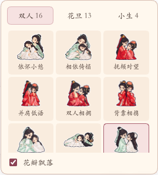

  
  <h1>花妖桌宠 · Hua Yao Pet</h1>
  
把越剧《花妖》的花旦和小生请到桌面。点一下，会轻轻跳一下，回你一句戏台上的话。

  
  
  
  
  
  

  <a href="#桌宠预览">桌宠预览</a> ·
  <a href="#下载与安装">下载与安装</a> ·
  <a href="#关于越剧花妖">剧目与主创</a> ·
  <a href="#代码许可与立绘使用">代码许可与立绘使用</a>

> **越剧《花妖》饭制作品。** MIT 许可仅适用于本项目的自有软件代码与构建文件。立绘与人物形象不对外授权，禁止商用，仅作越剧《花妖》宣传之用。

## 桌宠预览

<table>
  <tr>
    <td align="center"><strong>macOS 独立桌宠</strong></td>
    <td align="center" colspan="2"><strong>DeepSeek Harness 插件</strong></td>
  </tr>
  <tr>
    <td align="center"></td>
    <td align="center"></td>
    <td align="center"></td>
  </tr>
  <tr>
    <td align="center">桌面上的双人合照与台词</td>
    <td align="center">Harness 窗口右下角的花妖</td>
    <td align="center">双人、花旦、小生换装</td>
  </tr>
</table>

## 桌宠能做什么

| 玩法 | 说明 |
| --- | --- |
| **三种角色模式** | 双人模式使用 16 张双人合照，花旦有 13 款单人立绘，小生有 4 款。可以按缩略图挑选，三个模式各自记住上次使用的造型。 |
| **点击回话与花瓣** | 点人物会轻跳并弹出台词。花瓣可以关闭，独立版还可开关自动闲聊。 |
| **摆放桌面** | 独立版可以拖动、缩放、置顶或移到右下角。Windows 可用任务栏通知区域的图标显示、隐藏和退出桌宠。 |
| **AI 状态提醒** | 支持显示思考、调用工具、待确认、完成等状态。需要确认时，在对应 AI 应用里处理。 |
| **Harness 窗口内玩法** | 从 Harness 的插件页安装和停用，跟随当前会话。点「收起」可缩成状态按钮，点「花妖」展开。 |

### 三个版本怎么选

| 版本 | 显示位置 | 支持的联动 |
| --- | --- | --- |
| **macOS 独立版** | 系统桌面 | DeepSeek Harness、Codex、WorkBuddy 和 TRAE。TRAE 需要在「AI 联动」菜单里配置桥接。 |
| **Windows 独立版** | 系统桌面 | DeepSeek Harness。安装包内置解压组件与运行库。 |
| **DeepSeek Harness 插件** | Harness 窗口右下角 | 当前 Harness 会话。同一个插件包面向 macOS 和 Windows。 |

## 下载与安装

| 版本 | 系统或应用要求 | 下载 |
| --- | --- | --- |
| **Windows 独立版 v1.0.0** | Windows 10 22H2 或 Windows 11，x64 | [Windows ZIP](https://github.com/giifft/huayao-harness-pet/releases/download/desktop-v1.2.0/huayao-desktop-windows-x64.zip) |
| **macOS 独立版 v1.2.0** | Apple 芯片，macOS 13 或更新 | [macOS ZIP](https://github.com/giifft/huayao-harness-pet/releases/download/desktop-v1.2.0/huayao-desktop-macos-arm64.zip) |
| **Harness 插件 v1.0.0** | 支持安装第三方插件的 DeepSeek Harness | [插件 TGZ](https://github.com/giifft/huayao-harness-pet/releases/download/v1.0.0/huayao-harness-pet-1.0.0.tgz) |

1. **Windows**　完整解压 ZIP，打开 `HuaYaoPet-Windows-x64` 文件夹并双击 `HuaYaoPet.exe`。把 EXE 和同目录的文件一并保留。
2. **macOS**　解压 ZIP，把「花妖桌宠.app」拖到「应用程序」后打开。顶部菜单栏的戏曲面具图标可以打开菜单。
3. **Harness 插件**　在 Harness 左侧打开「插件 → 添加插件」，粘贴 `.tgz` 的完整本地路径。安装后点「立即启用」，再回到聊天页。

[独立版安装与功能 PDF](https://github.com/giifft/huayao-harness-pet/releases/download/desktop-v1.2.0/huayao-desktop-install-guide-zh-CN.pdf) · [Harness 插件安装与功能 PDF](https://github.com/giifft/huayao-harness-pet/releases/download/v1.0.0/huayao-harness-install-guide-zh-CN.pdf)

Windows 独立版已通过 Windows 运行器的窗口启动与 Harness 会话读取测试。Harness 插件在 Mac 上用 0.2.2-rc.5 的隔离环境验证了安装、启用和交互，Windows 桌面客户端仍待实机验证。Windows 独立安装包未做数字签名，macOS 包未做 Apple 公证。[Windows 自动测试记录](https://github.com/giifft/huayao-harness-pet/actions/runs/45171844566)

## 关于越剧《花妖》

越剧《花妖》取材于蒲松龄《聊斋志异·香玉》。黄生与花妖香玉、绛雪相遇，故事由相知写到离别与守候。李旭丹饰香玉、绛雪，王婉娜饰黄生。

### 主创团队

| 职务 | 主创 |
| --- | --- |
| 出品人／制作人 | 李旭丹 |
| 艺术指导 | 王志萍 |
| 主演 | 李旭丹 饰 香玉／绛雪，王婉娜 饰 黄生 |
| 编剧 | 魏睿 |
| 导演／舞美设计／平面设计／多媒体设计 | 朱燕鸣 |
| 副导演 | 牟元笛 |
| 影像导演 | 杨君武 |
| 唱腔设计 | 黄莺 |
| 作曲／编曲 | 蒋笑、刘星羽 |
| 伴奏制作／编曲 | 江君亮 |
| 灯光设计 | 缪伟 |
| 造型设计 | 蒋沁颖 |
| 服装设计 | 李旭丹 |
| 服装制作 | 庞丽丽（绍兴市兰曦秀服饰设计有限公司） |
| 摄影 | 张予希、俞旭紊、余秀鹏 |

### 演出与购票信息

- 时间　2026 年 12 月 12 日至 13 日，每晚 19:15
- 地点　上海长江剧场·黑匣子
- 票价　280 元／380 元

## 源码与版本记录

| 部分 | 路径 | 构建 |
| --- | --- | --- |
| macOS 独立版（Swift／AppKit） | [Sources/HuaYaoPet](Sources/HuaYaoPet) | `bash Scripts/build.sh` |
| Windows 独立版（.NET／WPF） | [WindowsPet](WindowsPet/README.md) | `dotnet publish WindowsPet/Desktop -c Release -r win-x64 --self-contained true` |
| Harness 插件（React／Cordis） | [HarnessPlugin](HarnessPlugin/README.md) | `bash HarnessPlugin/scripts/build.sh` |

- [独立版 Release](https://github.com/giifft/huayao-harness-pet/releases/tag/desktop-v1.2.0)　macOS v1.2.0 和 Windows v1.0.0。
- [Harness 插件 Release](https://github.com/giifft/huayao-harness-pet/releases/tag/v1.0.0)　Harness 窗口内的花妖桌宠 v1.0.0。

## 代码许可与立绘使用

项目自有软件代码和构建文件采用 MIT 许可，第三方组件沿用各自许可。[MIT LICENSE](LICENSE)

本桌宠为越剧《花妖》饭制作品。本案立绘与人物形象不对外授权，禁止商用，仅作越剧《花妖》宣传之用，无商业用途。二创产生的一切衍生权益归越剧《花妖》出品人李旭丹女士所有。[立绘使用声明](NOTICE-ARTWORK.zh-CN.txt)
