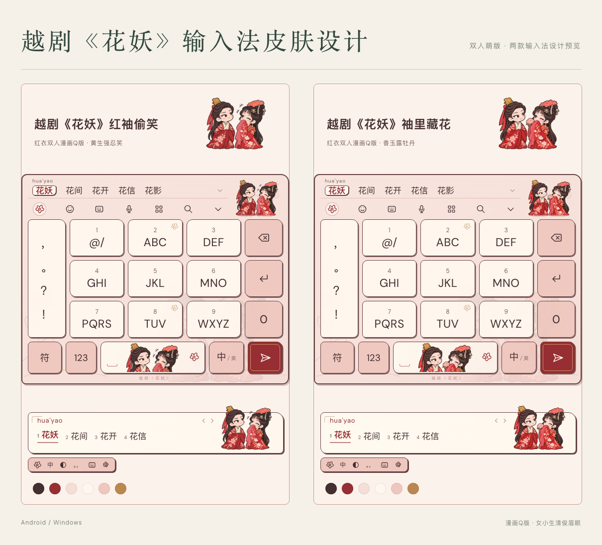

  
  <h1>花妖桌宠 · Hua Yao Pet</h1>
  
把越剧《花妖》的花旦和小生请到桌面。点一下，会轻轻跳一下，回你一句戏台上的话。

  
  
  
  
  
  

  <a href="#桌宠预览">桌宠预览</a> ·
  <a href="#下载与安装">下载与安装</a> ·
  <a href="#关于越剧花妖">剧目与主创</a> ·
  <a href="#代码许可与立绘使用">代码许可与立绘使用</a>

> **越剧《花妖》饭制作品。** MIT 许可仅适用于本项目的自有软件代码与构建文件。立绘与人物形象不对外授权，禁止商用，仅作越剧《花妖》宣传之用。

## 桌宠预览

  

### 双人 Q 版输入法设计预览

「红袖偷笑」与「袖里藏花」的角色也可在桌宠双人模式选用。下图展示两款皮肤的九键与桌面候选窗设计。

## 桌宠能做什么

| 玩法 | 说明 |
| --- | --- |
| **三种角色模式** | 双人模式使用 18 款双人、13 款花旦和 4 款小生 Q 版立绘。可以按缩略图挑选，三个模式各自记住上次使用的造型。 |
| **点击回话与花瓣** | 点人物会轻跳并弹出台词。花瓣可以关闭，独立版还可开关自动闲聊。 |
| **摆放桌面** | 独立版可以拖动、缩放、置顶或移到右下角。Windows 可用任务栏通知区域的图标显示、隐藏和退出桌宠。 |
| **AI 状态提醒** | 支持显示思考、调用工具、待确认、完成等状态。需要确认时，在对应 AI 应用里处理。 |
| **Harness 窗口内玩法** | 从 Harness 的插件页安装和停用，跟随当前会话。还支持拖动记位、状态换姿、花台陪伴和本地存档。 |

### 三个版本怎么选

| 版本 | 显示位置 | 支持的联动 |
| --- | --- | --- |
| **macOS 独立版** | 系统桌面 | DeepSeek Harness、Codex、WorkBuddy 和 TRAE。TRAE 需要在「AI 联动」菜单里配置桥接。 |
| **Windows 独立版** | 系统桌面 | DeepSeek Harness。安装包内置解压组件与运行库。 |
| **DeepSeek Harness 插件** | Harness 窗口右下角 | 当前 Harness 会话。同一个插件包面向 macOS 和 Windows。 |

常规联动默认开启。macOS 就地读取 Codex 和 Harness 的会话日志、查询 WorkBuddy 本地任务状态。Windows 就地读取 Harness 会话日志。桌宠从日志提取状态与工具类别，可在联动菜单按平台关闭。TRAE 需要先配置 Hooks。关闭 TRAE 联动或退出桌宠会停止接收状态，删除桌宠前可在「AI 联动 → 移除 TRAE 联动」清理桌宠添加的 Hooks 和辅助程序。

## 下载与安装

| 版本 | 系统或应用要求 | 下载 |
| --- | --- | --- |
| **Windows 独立版 v1.0.2** | Windows 10 22H2 或 Windows 11，x64 | [Windows ZIP](https://github.com/giifft/huayao-harness-pet/releases/download/v1.2.2/huayao-desktop-windows-x64.zip) |
| **macOS 独立版 v1.2.2** | Apple 芯片，macOS 13 或更新 | [macOS ZIP](https://github.com/giifft/huayao-harness-pet/releases/download/v1.2.2/huayao-desktop-macos-arm64.zip) |
| **Harness 插件 v1.1.1** | 支持安装第三方插件的 DeepSeek Harness | [插件 TGZ](https://github.com/giifft/huayao-harness-pet/releases/download/v1.2.2/huayao-harness-pet-1.1.1.tgz) |

1. **Windows**　完整解压 ZIP，打开 `HuaYaoPet-Windows-x64` 文件夹并双击 `HuaYaoPet.exe`。把 EXE 和同目录的文件一并保留。
2. **macOS**　解压 ZIP，把「花妖桌宠.app」拖到「应用程序」后打开。顶部菜单栏的戏曲面具图标可以打开菜单。
3. **Harness 插件**　在 Harness 左侧打开「插件 → 添加插件」，粘贴 `.tgz` 的完整本地路径。安装后点「立即启用」，再回到聊天页。

Windows 安装包为自包含构建，未做数字签名。macOS 安装包适用于 Apple 芯片，未做 Apple 公证。Harness 插件支持可安装第三方插件的 0.2.2 系列桌面版。

## 关于越剧《花妖》

越剧《花妖》取材于蒲松龄《聊斋志异·香玉》。黄生与花妖香玉、绛雪相遇，故事由相知写到离别与守候。李旭丹饰香玉、绛雪，王婉娜饰黄生。

### 主创团队

| 职务 | 主创 |
| --- | --- |
| 出品人／制作人 | 李旭丹 |
| 艺术指导 | 王志萍 |
| 主演 | 李旭丹 饰 香玉／绛雪，王婉娜 饰 黄生 |
| 编剧 | 魏睿 |
| 导演／舞美设计／平面设计／多媒体设计 | 朱燕鸣 |
| 副导演 | 牟元笛 |
| 影像导演 | 杨君武 |
| 唱腔设计 | 黄莺 |
| 作曲／编曲 | 蒋笑、刘星羽 |
| 伴奏制作／编曲 | 江君亮 |
| 灯光设计 | 缪伟 |
| 造型设计 | 蒋沁颖 |
| 服装设计 | 李旭丹 |
| 服装制作 | 庞丽丽（绍兴市兰曦秀服饰设计有限公司） |
| 摄影 | 张予希、俞旭紊、余秀鹏 |

### 演出与购票信息

- 时间　2026 年 12 月 12 日至 13 日，每晚 19:15
- 地点　上海长江剧场·黑匣子
- 票价　280 元／380 元

## 源码与版本记录

| 部分 | 路径 | 构建 |
| --- | --- | --- |
| macOS 独立版（Swift／AppKit） | [Sources/HuaYaoPet](Sources/HuaYaoPet) | `bash Scripts/build.sh` |
| Windows 独立版（.NET／WPF） | [WindowsPet](WindowsPet/README.md) | `dotnet publish WindowsPet/Desktop -c Release -r win-x64 --self-contained true` |
| Harness 插件（React／Cordis） | [HarnessPlugin](HarnessPlugin/README.md) | `bash HarnessPlugin/scripts/build.sh` |

macOS 版支持豆包桌面端联动，覆盖当前窗口里的普通对话。豆包联动默认关闭。在花妖桌宠菜单单独开启「AI 联动 → 豆包」，并在 macOS「系统设置 → 隐私与安全性 → 辅助功能」为花妖桌宠授权。桌宠仅在豆包位于前台时读取普通对话的可访问文本。回复连续更新时，桌宠会提示正在回话，停止更新约 7 秒后回到空闲。聊天文本仅在本地内存中用于比对变化。短回复可能在轮询间隔内结束，因此可能跳过正在回话的提示。

[当前版本 Release](https://github.com/giifft/huayao-harness-pet/releases/tag/v1.2.2) 提供 macOS v1.2.2、Windows v1.0.2 和 Harness 插件 v1.1.1。

## 代码许可与立绘使用

项目自有软件代码和构建文件采用 MIT 许可，第三方组件沿用各自许可。[MIT LICENSE](LICENSE)

本桌宠为越剧《花妖》饭制作品。本案立绘与人物形象不对外授权，禁止商用，仅作越剧《花妖》宣传之用，无商业用途。二创产生的一切衍生权益归越剧《花妖》出品人李旭丹女士所有。[立绘使用声明](NOTICE-ARTWORK.zh-CN.txt)
